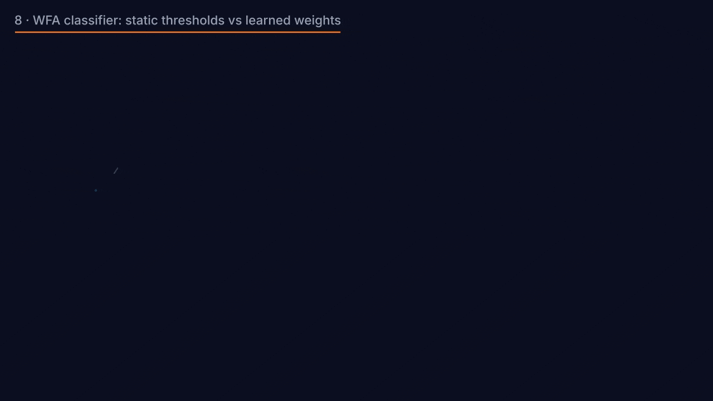
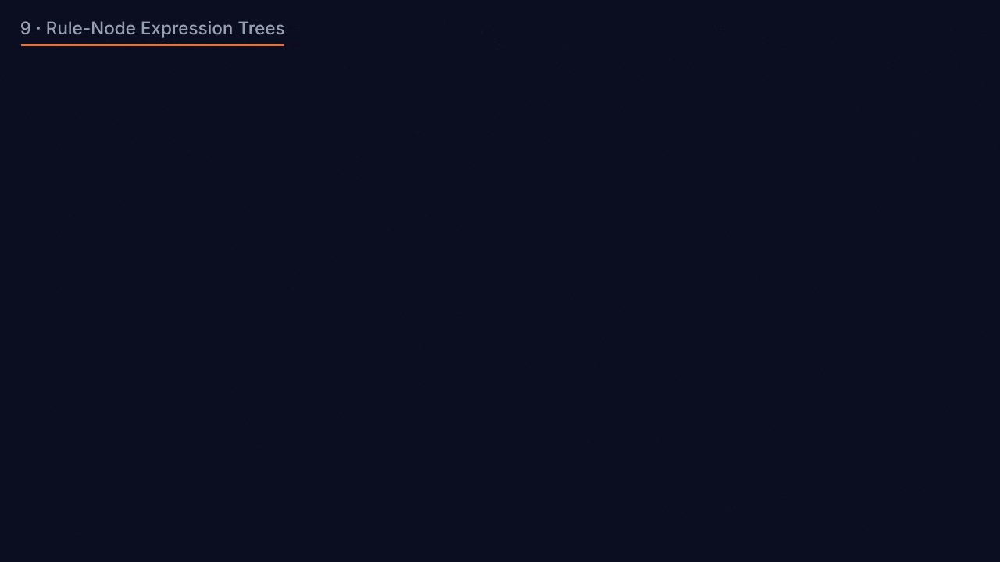
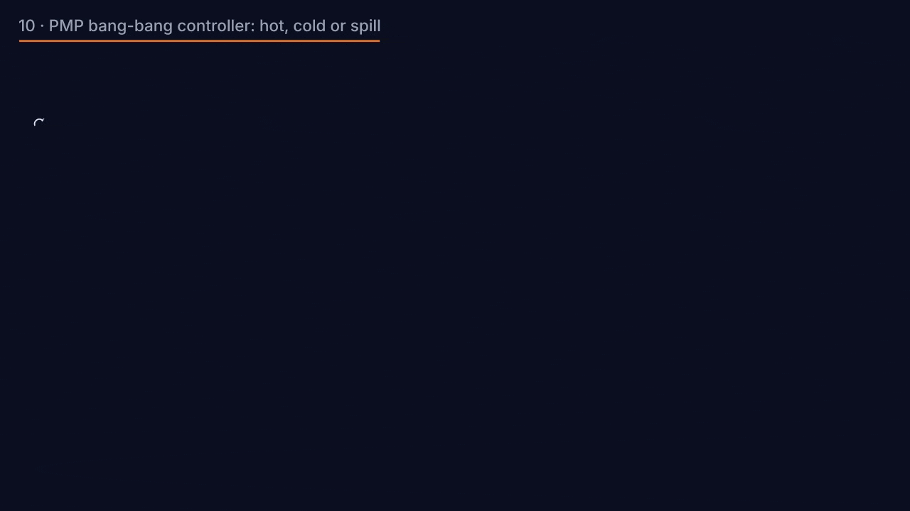
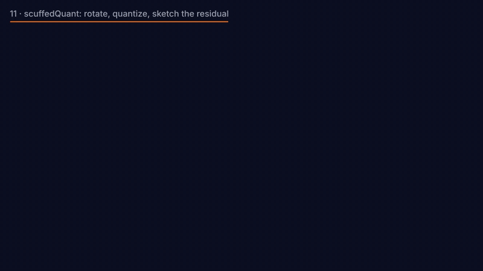
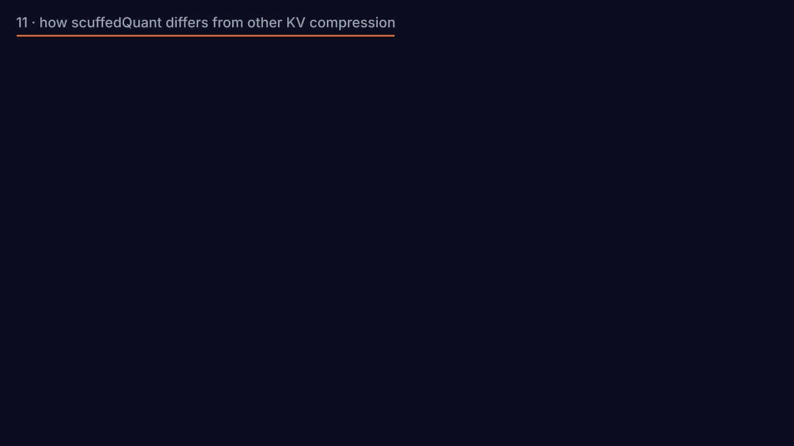

# ScuffedRDMA

Adaptive RDMA middleware for disaggregated LLM inference over commodity Ethernet.


MS Computer Science thesis, SUNY New Paltz. Author: Nathan Gopee. Advisors: Dr. Wafi Danesh, Dr. Ashley Suchy.

---

## Problem

Disaggregated prefill/decode serving moves the KV cache across nodes: prefill writes it once in bulk, decode needs small, latency-critical pieces of it every step. On commodity 10GbE, one RDMA queue pair carries both, so a few-hundred-byte decode transfer waits behind multi-megabyte prefill blocks (head-of-line blocking). libscuffedrdma splits traffic into a hot and a cold class, each on its own queue pair or endpoint with its own completion handling, and decides per transfer which class it belongs to.

## The thesis, section by section

Each part has a short animation, a one-paragraph summary and its key math. Every title links to a write-up in [`docs/explained/`](docs/explained/) with the full derivations and proofs. Animations are made with [Manim Community](https://github.com/ManimCommunity/manim) from [`docs/animations/`](docs/animations/). Their numbers are arithmetic or come from a results file in this repo, except where marked illustrative.

**Color key:** orange = hot (latency-critical), blue = cold (bulk), violet = storage spill, green = decision or check passed, red = stall or failure.

### [1. What moves: network and storage](docs/explained/01-traffic.md)


Each token leaves a key and a value at every layer. A new token's query is compared with every cached key, a softmax turns the scores into weights, and the output is the weighted sum of the cached values. The cache is exact (later tokens never change earlier keys or values, because of the causal mask), so prefill can build it on one server and decode can use it on another.


Prefill on server 1 writes K and V for every layer and ships them to decode on server 2. While that bulk streams, other requests need small, urgent messages on the same link (control blobs, credits, token ids). When decode GPU memory passes a watermark, cold KV spills to NVMe instead of being recomputed.

```math
o_t = \sum_{i \le t} \mathrm{softmax}_i\!\left(\frac{\langle q_t, k_i\rangle}{\sqrt{d}}\right) v_i, \qquad \text{KV per token per layer} = 2 \times h_{kv} \times d_{\text{head}} \times \text{bytes} = 2 \times 8 \times 64 \times 2 = 2\ \text{KiB} \quad (\text{Granite 3.3-2B, bf16})
```

A 2,048-token prompt is 2 KiB × 40 layers × 2,048 = 160 MiB, which takes 134 ms to serialize at 10 Gb/s.

### [2. Head-of-line blocking](docs/explained/02-head-of-line-blocking.md)


With one queue, a small message waits for every byte queued in front of it. The dual pool gives hot traffic its own queue, so nothing bulk sits ahead of it. Below the queues the NIC and wire are still shared, and experiment E3 measures whether SoftRoCE keeps the separation.

```math
W_{\text{FIFO}} = \frac{8}{C}\sum_{\text{ahead}} s_i \;=\; 4 \times 0.84\ \text{ms} = 3.36\ \text{ms} \quad\text{(four 1 MiB blocks at 10 Gb/s)}
```

On average (M/G/1 queue, Pollaczek–Khinchine) every message waits $`W = \frac{\lambda\,\mathbb E[S^2]}{2(1-\rho)}`$, which depends on the square of message sizes, so a few huge messages make everyone wait.

### [3. Where industry stands](docs/explained/03-industry.md)


The existing tools are built for one kind of traffic at a time, and the libfabric path the serving stack ships needs EFA-class hardware. On commodity Ethernet, mixed hot/cold traffic is left to whatever the library does underneath.

| problem | evidence |
|---|---|
| RDT, Mooncake, NIXL, LMCache move bulk only; none separates hot from cold | Update 7 |
| NIXL's `LIBFABRIC` backend picks cxi, efa, tcp or sockets (never verbs) and needs GPUDirect RDMA | nixl `d642316` |
| UCX's `mmap` hooks leaked 400 MB/min in disaggregated vLLM | [Mistral](https://mistral.ai/news/debugging-memory-leak-in-vllm) |
| GPFS fell back to TCP silently after QP errors (APAR IV61625) | Update 7 |
| Unchecked completion status produced this project's withdrawn 8 µs figure | `check_completion` |

### [4. The dual pool on libfabric](docs/explained/04-dual-pool.md)


Each traffic class gets its own libfabric endpoint, completion queue and provider. Hot busy-polls for the lowest latency; cold sleeps on a wait object and keeps a deep queue. `libscuffedverbs` implements the same API on raw verbs, so one benchmark compares the two libraries.

| | hot | cold |
|---|---|---|
| queue depth | 64 | 512 |
| completion | busy-polled CQ or `fi_cntr` | CQ with wait object, `fi_cq_sread` |
| provider / type | per class: `verbs` MSG, `verbs;ofi_rxm` RDM, `tcp`, `shm` | same choice, independent of hot |

### [5. FabricBlobChannel: credits and one-sided writes](docs/explained/05-blob-channel.md)


The sender holds one credit per free receive slot at the peer. It writes a chunk and its notification in a single `fi_writedata` (`imm = DATA | slot`). The receiver copies the chunk out, then returns the credit with an 8-byte write on the hot endpoint. A slot is never overwritten while in use, and the notification can't arrive before its data.

```math
\text{throughput} \;\le\; \frac{N \cdot B}{R} \qquad (N \text{ slots of } B \text{ bytes, credit round trip } R;\ \text{Little's law})
```

### [6. How the receiver learns data arrived](docs/explained/06-completion-signaling.md)


A one-sided write lands without the target's CPU, so the target needs a signal. Each of the five options relies on a different ordering guarantee. Experiment E5 measures p99 latency and instructions per post for each.

| mechanism | relies on |
|---|---|
| CQ data (write with immediate) | completion is generated after the data is placed |
| flag in payload | the NIC placing the last bytes last (not guaranteed for multi-packet writes) |
| sentinel write | write-after-write ordering (`FI_ORDER_WAW`; `shm` lacks it) |
| remote-write counter | counter bumped at completion (`tcp` did not count) |
| write + 8-byte read | in-order execution on RC; the GPFS flush pattern |

### [7. ScuffedRdmaConnector inside vLLM](docs/explained/07-connector.md)


The proxy sends the prompt to prefill with `max_tokens=1` and a transfer id. Each attention layer pushes its KV as one blob (bulk cold, the done marker hot). Decode loads layer by layer into its paged cache. A missing layer is recomputed, and a failed libfabric open falls back to TCP with a telemetry event.

```math
\text{staging cost per layer} \approx \frac{b}{P_{\text{PCIe}}} \quad\text{vs}\quad \frac{8b}{C}\ \text{on the wire} \qquad (4\ \text{MiB}: \approx 0.2\ \text{ms vs } 3.4\ \text{ms})
```

### [8. WFA classifier: static thresholds vs learned weights](docs/explained/08-wfa-classifier.md)



Each tensor has a cold/warm/hot automaton; hot goes to the hot endpoint. The static version uses size thresholds and a phase detector that never sees decode, because decode visits layers in order just like prefill. So most decode KV deltas go cold. The learned version scores the next state from the transfer's features and can hold a different size cutoff per phase.

```math
P(s' \mid s, x) = \frac{\exp\big(W_{s,s'}\cdot\varphi(x)\big)}{\sum_{r} \exp\big(W_{s,r}\cdot\varphi(x)\big)}, \qquad \frac{\partial \mathcal L}{\partial W_{s,r}} = \frac1N\sum_{n:\,s_n=s}\big(P_{n,r} - \mathbb 1[r=y_n]\big)\varphi_n + \lambda W_{s,r}
```

### [9. Rule-Node Expression Trees](docs/explained/09-policy-trees.md)



Rules are boolean trees over signals and context (GPU memory, link load), tried in priority order. Each sets `route` (hot, cold, spill) and/or `compress`, and the first rule to set a field owns it. Example: a 4 MiB prefill block at 93% GPU memory and 85% link load is spilled (rule 90) and compressed (rule 60).

```math
\text{route} = \text{action of } \min\{\, i : \text{rule}_i \text{ matches and sets route} \,\}, \qquad \text{cost} = O(\text{nodes in the policy})
```

### [10. PMP bang-bang controller: hot, cold or spill](docs/explained/10-pmp-controller.md)



For each transfer the controller picks hot, cold or spill. Its cost is a straight-line function of the choice, so the best choice is always all-or-nothing (bang-bang), never a split. It picks the option with the smallest cost, where each queue's cost is approximated by its weighted depth. One caveat: the derivation shows the implemented switching rule's sign and rate scaling don't match the model it came from. That is written up and not yet fixed.

```math
\sigma_H = \alpha\, q_H\, C\mu_H, \qquad \sigma_C = \beta\, q_C\, C\mu_C, \qquad \sigma_S = \delta\, q_S\, \mu_S - \gamma\, \frac{\max(0,\,u - u_0)}{1-u_0}, \qquad \text{choose } \arg\min_i \sigma_i
```

### [11. scuffedQuant: rotate, quantize, sketch the residual](docs/explained/11-scuffedquant.md)



Each KV vector is rotated with a random-sign Hadamard transform so all coordinates look alike, quantized to 3 bits with a Lloyd–Max codebook, and its residual is sketched with 256 sign bits. Attention needs inner products, and the sketch corrects them (without bias for Gaussian projections, approximately for the ±1 ones the code uses). That is 64 bytes per vector at head_dim 64, 2× smaller than FP16, with 91.1% ± 3.3% top-8 attention overlap on Granite 3.3-2B.

```math
\langle q, k \rangle \approx \langle q, \hat k \rangle + \lVert r \rVert\, \frac{\sqrt{\pi/2}}{m} \sum_{j=1}^{m} \mathrm{sign}(S r)_j\, (S q)_j, \qquad 4 + 4 + \tfrac{64 \cdot 3}{8} + \tfrac{256}{8} = 64\ \text{B}
```



How it differs: FP8, KIVI and token eviction change the GPU cache that attention reads at every decode step. scuffedQuant leaves the GPU cache in bf16 and only shrinks the bytes of a transfer on the wire or on NVMe. It handles outlier channels with a rotation instead of per-group scales.

| bytes per K or V vector | bf16 | FP8 | KIVI 2-bit | scuffedQuant |
|---|---|---|---|---|
| head_dim 64 | 128 | 64 | about 24 + window | 64 |
| head_dim 128 | 256 | 128 | about 48 + window | 88 |
| where | | GPU cache | GPU cache | wire and NVMe only |

On the vLLM connector path the receiver rebuilds from the 3-bit part alone, so the sketch is not used there yet. Quality against FP8 and KIVI on the same KV is not measured yet.

### [12. NVMe storage tier](docs/explained/12-storage-tier.md)


Spilled blocks are batched into one `pwrite` + `fdatasync` in 4 KiB-aligned extents. Freed space is merged and reused first-fit, and reads are checked with CRC32. On server 2's NVMe, batching raised writes from 662 to 827 MB/s, matching a fixed-plus-per-block cost model whose limit is about 839 MB/s. Reads peaked at 20 blocks.

```math
\text{throughput}(n) = \frac{nB}{a + nb} \;\to\; \frac{B}{b} \approx 839\ \text{MB/s} \qquad (a \approx 1.6\ \text{ms},\ b \approx 1.91\ \text{ms per 1.5 MiB block})
```

## Components

| Component | Where | State |
|---|---|---|
| Dual pool on libfabric | `middleware/libscuffedfabric/` | built; tested here on tcp, tcp;ofi_rxm, shm; verbs provider runs on the cluster |
| Dual QP pool on libibverbs (C) | `middleware/libscuffedverbs/` | built; compile-checked here, runs on SoftRoCE |
| Dual QP pool (Python, pyverbs) | `middleware/rdma_tensor_cache/dual_qp_pool.py` | original MVP; completion status now checked |
| Python binding + blob channel | `middleware/fabric/` | `FabricPool`, `FabricBlobChannel` over either C library |
| Telemetry | `middleware/telemetry.py` | signal vectors, per-class histograms, QP error / reconnect / TCP-fallback events, Prometheus `/metrics` |
| WFA classifier | `middleware/rdma_tensor_cache/wfa_classifier.py`, `wfa_learner.py` | static thresholds; learned transition weights (gradient descent) with synthetic validation |
| Rule-Node Expression Trees | `middleware/policy/` | and/or/not/threshold/in/classifier nodes, priority rules, explanation traces |
| PMP controller | `middleware/rdma_tensor_cache/pmp_controller.py` | bang-bang hot/cold; with GPU memory pressure it can also choose SPILL |
| Storage tier | `middleware/rdma_tensor_cache/storage_tier.py` | NVMe spill/retrieve, coalescing, O_DIRECT, crc32 |
| scuffedQuant | `middleware/rdma_tensor_cache/scuffed_quant.py` | bit-packed wire format, size reported from packed bytes |
| vLLM connector | `middleware/vllm_plugin/` | `ScuffedRdmaConnector` on `KVConnectorBase_V1`, proxy, loopback check; tests pass against vLLM 620e8924 and 0.24.0 |
| NCCL net plugin | `middleware/nccl_plugin/` | `ncclNetPlugin_v8`, hot/cold QPs split at 4 KB; builds, not yet run under NCCL |

<details><summary>Static system map (Mermaid)</summary>


</details>

---

## Notebooks

Each notebook has a parameter cell. `MODE = "local"` runs smoke sizes on any Linux box with libfabric (tcp / shm providers), results to `/tmp`. `MODE = "cluster"` runs on server 1 and server 2, results to `benchmarks/results/`, tagged with hostname and UTC time. Notebook 08 has `MODE = "gpu"` for one machine with an NVIDIA GPU. Local numbers are smoke tests, not results.

| Notebook | What it runs |
|---|---|
| [00_environment_check](notebooks/00_environment_check.ipynb) | RDMA devices, GID table, libfabric providers, pyverbs, builds all native code, full test suite |
| [01_hol_blocking](notebooks/01_hol_blocking.ipynb) | hot RTT under a cold bulk stream, single vs dual endpoint, native verbs vs libfabric; re-run of the Update 4 pyverbs benchmark |
| [02_completion_signaling](notebooks/02_completion_signaling.ipynb) | CQ data vs flag-in-payload vs sentinel vs remote-write counter vs trailing READ, instructions per post |
| [03_libfabric_vs_libibverbs](notebooks/03_libfabric_vs_libibverbs.ipynb) | latency and bandwidth per stack, MSG / RDM / mixed endpoints, counters vs CQ, wait objects, blob channel vs TCP |
| [04_wfa_and_policy](notebooks/04_wfa_and_policy.ipynb) | learned WFA vs static thresholds, policy tree decisions with explanations |
| [05_scuffedquant](notebooks/05_scuffedquant.ipynb) | packed sizes, Granite 3.3-2B top-8 overlap per layer |
| [06_vllm_disagg_ttft](notebooks/06_vllm_disagg_ttft.ipynb) | ScuffedRdmaConnector loopback, TTFT / ITL sweeps against NIXL (UCX and LIBFABRIC backends) and single-node baselines |
| [07_storage_tier](notebooks/07_storage_tier.ipynb) | NVMe spill coalescing sweep, PMP spill choice |
| [08_local_gpu](notebooks/08_local_gpu.ipynb) | one GPU: connector with KV caches on the GPU, scuffedQuant on real KV, vLLM prefill + decode on one card through libfabric `shm`, greedy-output match and TTFT / ITL against a single instance and NIXL |

## Repository

| Path | Contents |
|------|----------|
| `middleware/` | Transports (TCP / SoftRoCE / TTPoe), RDMA bootstrap, telemetry, policy engine |
| `middleware/libscuffedfabric/` | libfabric dual-endpoint pool, `sf_bench` |
| `middleware/libscuffedverbs/` | libibverbs implementation of the same API, `sv_bench` |
| `middleware/fabric/` | ctypes binding, `FabricBlobChannel`, `TcpBlobChannel` |
| `middleware/rdma_tensor_cache/` | pyverbs dual QP pool, WFA (static + learned), PMP, scuffedQuant, storage tier |
| `middleware/vllm_plugin/` | ScuffedRdmaConnector, disagg proxy, loopback |
| `middleware/nccl_plugin/` | NCCL net plugin |
| `notebooks/` | research notebooks (generated from `notebooks/_build/`) |
| `docs/animations/`, `docs/media/` | Manim sources for the README animations (`render.sh`) and the rendered GIFs |
| `scripts/local_gpu/` | `setup_gpu_env.sh`: libfabric, CUDA torch, vLLM, builds and tests on a GPU machine (WSL2 or Linux) |
| `tests/`, `middleware/tests/` | pytest suite (`pytest -q` from the repo root) |
| `benchmarks/` | benchmark scripts, `fabric/runner.py`, `vllm_disagg/`, `test_arch/`, results |
| `deployment/` | Docker/K8s for server 1 / server 2, FA3 Blackwell patch |
| `Updates/` | Updates 1 through 8 and 5-2 (LaTeX + PDF), each with a README of the work and sources |
| `References/` | saved papers and pages; `Bookmarks_10-22/RANKED_SOURCES.md` ranks every source |
| `vllm/`, `uccl/` | submodules (reference / comparison) |
| `REFERENCES.md` | annotated bibliography |

## Hardware

| Node | Role | GPUs | VRAM | NIC | RDMA |
|------|------|------|------|-----|------|
| Server 1 | Prefill | 2× RTX 5090 | 64 GB | Intel X710 10GbE | SoftRoCE (X710 has no iWARP) |
| Server 2 | Decode | 3× RTX 3090 | 72 GB | Aquantia AQC107 10GbE | SoftRoCE |
| Server 3 | Dev | RTX 5070 Ti | 16 GB | ConnectX-4 100GbE | Hardware RoCEv2 |
| Server 4 | Dev | 2× Tesla V100 | 64 GB | ConnectX-4 100GbE | Hardware RoCEv2, GPUDirect |

---

## Results

Only numbers with a results file in the repo.

| Metric | Value | Source |
|--------|-------|--------|
| scuffedQuant 3-bit + 256-bit QJL, top-8 attention overlap (Granite 3.3-2B, FP32 KV) | 91.1% ± 3.3% over 40 layers (min 82.8%) | `benchmarks/results/scuffed_quant_llm.json` |
| scuffedQuant 3-bit top-8 (Granite 3.3-2B, MLX 4-bit) | 100.0% over 40 layers | `benchmarks/results/scuffed_quant_mlx.json` |
| scuffedQuant packed size at head_dim 64 | 64 B per vector: 2× vs FP16, 4× vs FP32 | `tests/test_scuffed_quant.py`, notebook 05 |
| NVMe spill, server 2, coalesce 1 → 50 blocks of 1.5 MiB | write 662 → 827 MB/s; read peaks 2188 MB/s at 20, 1104 MB/s at 50 | `benchmarks/results/test_arch/chimera_storage_spill.json` |
| Per-architecture scuffedQuant (Transformer, Mamba state, Granite 4 hybrid, MoE) on server 1 and server 2 | see Update 5-2 | `benchmarks/results/test_arch/` |

### Withdrawn, to be re-measured

- **Cross-node decode latency "8 µs"** (`dual_qp_remote_benchmark.json`). The pyverbs pool did not check `wc.status`, so error and flush completions counted as fast completions; 8 MB writes "finished" in about 8 µs, which 10GbE cannot do. Fixed in `dual_qp_pool.py` (`check_completion`); re-run in notebook 01.
- **"4× vs FP16" compression.** The ratio was against FP32. Against FP16 it is 2× at head_dim 64. `kv_compressed_bytes` in `scuffed_quant_llm.json` divides FP16 bytes by the FP32 ratio and is understated by 2×.
- **SoftRoCE bandwidth, single-QP p50, dual-QP overhead, FA3 Blackwell speedup, gpt-oss-120b tok/s.** Earlier README rows pointed at sources that do not hold them (backlog drafts, a different link speed, an Ollama run). Notebooks 01 to 03 re-measure the transport numbers on the current harness.

## Built

- [x] libfabric dual-endpoint pool, per-class endpoint type (MSG / RDM), hot completions via CQ or `fi_cntr`, cold CQ with a wait object, one MR per domain
- [x] Native libibverbs implementation of the same API; `sv_bench` and `sf_bench` share one source
- [x] Benchmarks: completion-signaling mechanisms, bandwidth, mixed hot/cold head-of-line test, instructions per post, CPU pinning, JSON output
- [x] Python binding and `FabricBlobChannel` (credit-based slots, notification and payload in one `fi_writedata`)
- [x] Unified telemetry with Prometheus exporter
- [x] Learned WFA transition weights and synthetic validation; Rule-Node Expression Tree policy engine
- [x] PMP spill choice under GPU memory pressure; NVMe storage tier with coalescing
- [x] `ScuffedRdmaConnector` for vLLM V1 (pinned vLLM 620e8924), disagg proxy, TTFT runner
- [x] NCCL net plugin builds and exports `ncclNetPlugin_v8`
- [x] Dual QP pool over SoftRoCE with WFA routing; PMP controller; RDMA bootstrap (handshake, GID discovery, QP state machine with retry); security audit fixes (Updates 4 and 5)
- [x] scuffedQuant on Granite 3.3-2B and per-architecture state (Updates 4 and 5-2)

## Planned

- [ ] Cluster runs of notebooks 01 to 03 on server 1 ↔ server 2 (SoftRoCE) and server 3 ↔ server 4 (ConnectX-4): the libfabric versus libibverbs comparison for Update 8
- [ ] Single-GPU end-to-end run on the desktop GPU (notebook 08): vLLM prefill + decode with the connector, greedy match, TTFT / ITL
- [ ] vLLM disaggregated serving with ScuffedRdmaConnector across nodes, TTFT / ITL against NIXL on UCX and on its LIBFABRIC backend (notebook 06)
- [ ] NIXL + Ray RDT view-count sweep over SoftRoCE with competing hot traffic (Update 7)
- [ ] NCCL plugin under NCCL with vLLM tensor parallel; PMP-driven split instead of the fixed 4 KB threshold
- [ ] Signal dumps from the transports into the learned WFA (notebook 04 cluster cell)
- [ ] GPUDirect RDMA on server 4 (blocked on the PVE kernel's `CONFIG_INFINIBAND_PEER_MEM`)

---

## Usage

```bash
# native code (needs libfabric-dev, libibverbs-dev / rdma-core)
make -C middleware/libscuffedfabric && make -C middleware/libscuffedverbs && make -C middleware/nccl_plugin

# tests
python3 -m pytest -q

# SoftRoCE on both nodes
sudo modprobe rdma_rxe && sudo rdma link add rxe0 type rxe netdev <10GbE iface>

# hot-path latency, libfabric verbs provider (server first, then client)
middleware/libscuffedfabric/sf_bench -r server -H <server ip> -p verbs -t msg -d rxe0 -m sig -M cq
middleware/libscuffedfabric/sf_bench -r client -H <server ip> -p verbs -t msg -d rxe0 -m sig -M cq

# same benchmark on native libibverbs
middleware/libscuffedverbs/sv_bench -r server -H <server ip> -d rxe0 -m hol
middleware/libscuffedverbs/sv_bench -r client -H <server ip> -d rxe0 -m hol

# vLLM connector data path without vLLM
python3 -m middleware.vllm_plugin.loopback --role both --transport fabric --provider tcp

# GPU machine (Ubuntu under WSL2, or Linux): CUDA torch + vLLM + libfabric, builds, tests
bash scripts/local_gpu/setup_gpu_env.sh            # then notebooks/08_local_gpu.ipynb with MODE = "gpu"
```

The notebooks wrap all of this; start with `notebooks/00_environment_check.ipynb` on each node.

## Timeline

| Window | Milestone | Status |
|--------|-----------|--------|
| Jan–Feb 2026 | Hardware bring-up, Updates 1–3 | done |
| Mar–Apr 2026 | Python MVP, scuffedQuant, Updates 4, 5, 5-2, 6 | done |
| Sep 2026 | Transport landscape (Update 7) | done |
| Oct 2026 | libfabric pool, native verbs pool, connector, policy, telemetry, notebooks | built |
| Oct–Nov 2026 | Cluster runs, Update 8 (libfabric), full thesis draft | in progress |
| Dec 2026 | Defense | planned |

## Citations

Full bibliography in [REFERENCES.md](REFERENCES.md); ranked source list in [References/Bookmarks_10-22/RANKED_SOURCES.md](References/Bookmarks_10-22/RANKED_SOURCES.md). Core references:

- Kwon et al., *PagedAttention*, SOSP 2023. [arXiv:2309.06180](https://arxiv.org/abs/2309.06180)
- Zandieh et al., *TurboQuant*. [arXiv:2504.19874](https://arxiv.org/abs/2504.19874)
- Zandieh, Daliri, Han, *QJL: 1-Bit Quantized JL Transform for KV Cache Quantization*. [arXiv:2406.03482](https://arxiv.org/abs/2406.03482)
- Grun et al., *A Brief Introduction to the OpenFabrics Interfaces*, HotI 2015. libfabric man pages: `fi_endpoint(3)`, `fi_cntr(3)`, `fi_mr(3)`, `fi_verbs(7)`, `fi_rxm(7)`
- Licker, Hu, Zaytsev, Chen, *fabric-lib: RDMA Point-to-Point Communication for LLM Systems* (formerly TransferEngine; closest system-level comparison). [arXiv:2510.27656](https://arxiv.org/abs/2510.27656)
- NIXL libfabric plugin (the stock stack's libfabric path; baseline in notebooks 06 and 08). [ai-dynamo/nixl](https://github.com/ai-dynamo/nixl/tree/main/src/plugins/libfabric)
- Pontryagin et al., *The Mathematical Theory of Optimal Processes*, 1962.

## License

[MIT](LICENSE). Author: Nathan Gopee
