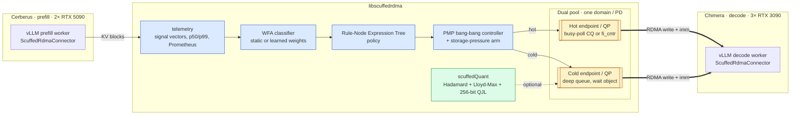
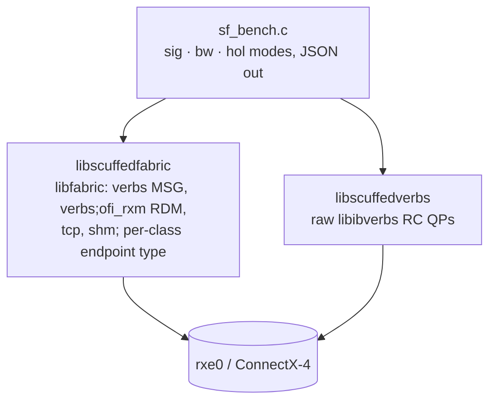
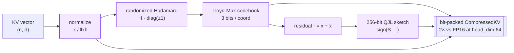

# ScuffedRDMA

Adaptive RDMA middleware for disaggregated LLM inference over commodity Ethernet.

MS Computer Science thesis, SUNY New Paltz. Author: Nathan Gopee. Advisors: Dr. Wafi Danesh, Dr. Ashley Suchy.

---

## Problem

Disaggregated prefill/decode serving moves the KV cache across nodes: prefill writes it once in bulk, decode needs small, latency-critical pieces of it every step. On commodity 10GbE, one RDMA queue pair carries both, so a few-hundred-byte decode transfer waits behind multi-megabyte prefill blocks (head-of-line blocking). libscuffedrdma splits traffic into a hot and a cold class, each on its own queue pair or endpoint with its own completion handling, and decides per transfer which class it belongs to.

## Approach

### System architecture



### Two implementations of the pool, one benchmark



Both libraries export the same C API (`middleware/libscuffedfabric/scuffed_fabric.h`), so `sf_bench` and `sv_bench` are the same benchmark source linked against different transports. libfabric versus libibverbs differences come from the library, not the harness.

### scuffedQuant pipeline



TurboQuant-style rotate, quantize, and sketch the residual (Zandieh et al.); the sketch is QJL (Zandieh, Daliri, Han). Individual vectors are lossy; inner products are preserved. At head_dim 64 a vector packs to 64 bytes: 2× against FP16, 4× against FP32.

### Components

| Component | Where | State |
|---|---|---|
| Dual pool on libfabric | `middleware/libscuffedfabric/` | built; tested here on tcp, tcp;ofi_rxm, shm; verbs provider runs on the cluster |
| Dual QP pool on libibverbs (C) | `middleware/libscuffedverbs/` | built; compile-checked here, runs on SoftRoCE |
| Dual QP pool (Python, pyverbs) | `middleware/rdma_tensor_cache/dual_qp_pool.py` | original MVP; completion status now checked |
| Python binding + blob channel | `middleware/fabric/` | `FabricPool`, `FabricBlobChannel` over either C library |
| Telemetry | `middleware/telemetry.py` | signal vectors, per-class histograms, QP error / reconnect / TCP-fallback events, Prometheus `/metrics` |
| WFA classifier | `middleware/rdma_tensor_cache/wfa_classifier.py`, `wfa_learner.py` | static thresholds; learned transition weights (gradient descent) with synthetic validation |
| Rule-Node Expression Trees | `middleware/policy/` | and/or/not/threshold/in/classifier nodes, priority rules, explanation traces |
| PMP controller | `middleware/rdma_tensor_cache/pmp_controller.py` | bang-bang hot/cold; storage-pressure arm returns HOT/COLD/SPILL |
| Storage tier | `middleware/rdma_tensor_cache/storage_tier.py` | NVMe spill/retrieve, coalescing, O_DIRECT, crc32 |
| scuffedQuant | `middleware/rdma_tensor_cache/scuffed_quant.py` | bit-packed wire format, size reported from packed bytes |
| vLLM connector | `middleware/vllm_plugin/` | `ScuffedRdmaConnector` on `KVConnectorBase_V1`, proxy, loopback check |
| NCCL net plugin | `middleware/nccl_plugin/` | `ncclNetPlugin_v8`, hot/cold QPs split at 4 KB; builds, not yet run under NCCL |

---

## Notebooks

Each notebook has a parameter cell. `MODE = "local"` runs smoke sizes on any Linux box with libfabric (tcp / shm providers), results to `/tmp`. `MODE = "cluster"` runs on Cerberus and Chimera, results to `benchmarks/results/`, tagged with hostname and UTC time. Local numbers are smoke tests, not results.

| Notebook | What it runs |
|---|---|
| [00_environment_check](notebooks/00_environment_check.ipynb) | RDMA devices, GID table, libfabric providers, pyverbs, builds all native code, full test suite |
| [01_hol_blocking](notebooks/01_hol_blocking.ipynb) | hot RTT under a cold bulk stream, single vs dual endpoint, native verbs vs libfabric; re-run of the Update 4 pyverbs benchmark |
| [02_completion_signaling](notebooks/02_completion_signaling.ipynb) | CQ data vs flag-in-payload vs sentinel vs remote-write counter vs trailing READ, instructions per post |
| [03_libfabric_vs_libibverbs](notebooks/03_libfabric_vs_libibverbs.ipynb) | latency and bandwidth per stack, MSG / RDM / mixed endpoints, counters vs CQ, wait objects, blob channel vs TCP |
| [04_wfa_and_policy](notebooks/04_wfa_and_policy.ipynb) | learned WFA vs static thresholds, policy tree decisions with explanations |
| [05_scuffedquant](notebooks/05_scuffedquant.ipynb) | packed sizes, Granite 3.3-2B top-8 overlap per layer |
| [06_vllm_disagg_ttft](notebooks/06_vllm_disagg_ttft.ipynb) | ScuffedRdmaConnector loopback, TTFT / ITL sweeps against NIXL and single-node baselines |
| [07_storage_tier](notebooks/07_storage_tier.ipynb) | NVMe spill coalescing sweep, PMP storage arm |

## Repository

| Path | Contents |
|------|----------|
| `middleware/` | Transports (TCP / SoftRoCE / TTPoe), RDMA bootstrap, telemetry, policy engine |
| `middleware/libscuffedfabric/` | libfabric dual-endpoint pool, `sf_bench` |
| `middleware/libscuffedverbs/` | libibverbs implementation of the same API, `sv_bench` |
| `middleware/fabric/` | ctypes binding, `FabricBlobChannel`, `TcpBlobChannel` |
| `middleware/rdma_tensor_cache/` | pyverbs dual QP pool, WFA (static + learned), PMP, scuffedQuant, storage tier |
| `middleware/vllm_plugin/` | ScuffedRdmaConnector, disagg proxy, loopback |
| `middleware/nccl_plugin/` | NCCL net plugin |
| `notebooks/` | research notebooks (generated from `notebooks/_build/`) |
| `tests/`, `middleware/tests/` | pytest suite (`pytest -q` from the repo root) |
| `benchmarks/` | benchmark scripts, `fabric/runner.py`, `vllm_disagg/`, `test_arch/`, results |
| `deployment/` | Docker/K8s for Chimera/Cerberus, FA3 Blackwell patch |
| `Updates/` | Updates 1 through 7 and 5-2 (LaTeX + PDF), each with a README of the work and sources; Update 8 draft |
| `References/` | saved papers and pages; `Bookmarks_10-22/RANKED_SOURCES.md` ranks every source |
| `vllm/`, `uccl/` | submodules (reference / comparison) |
| `REFERENCES.md` | annotated bibliography |

## Hardware

| Node | Role | GPUs | VRAM | NIC | RDMA |
|------|------|------|------|-----|------|
| Cerberus | Prefill | 2× RTX 5090 | 64 GB | Intel X710 10GbE | SoftRoCE (X710 has no iWARP) |
| Chimera | Decode | 3× RTX 3090 | 72 GB | Aquantia AQC107 10GbE | SoftRoCE |
| Tower 1 | Dev | RTX 5070 Ti | 16 GB | ConnectX-4 100GbE | Hardware RoCEv2 |
| Tower 2 | Dev | 2× Tesla V100 | 64 GB | ConnectX-4 100GbE | Hardware RoCEv2, GPUDirect |

---

## Results

Only numbers with a results file in the repo.

| Metric | Value | Source |
|--------|-------|--------|
| scuffedQuant 3-bit + 256-bit QJL, top-8 attention overlap (Granite 3.3-2B, FP32 KV) | 91.1% ± 3.3% over 40 layers (min 82.8%) | `benchmarks/results/scuffed_quant_llm.json` |
| scuffedQuant 3-bit top-8 (Granite 3.3-2B, MLX 4-bit) | 100.0% over 40 layers | `benchmarks/results/scuffed_quant_mlx.json` |
| scuffedQuant packed size at head_dim 64 | 64 B per vector: 2× vs FP16, 4× vs FP32 | `tests/test_scuffed_quant.py`, notebook 05 |
| NVMe spill, Chimera, coalesce 1 → 50 blocks of 1.5 MiB | write 662 → 827 MB/s; read peaks 2188 MB/s at 20, 1104 MB/s at 50 | `benchmarks/results/test_arch/chimera_storage_spill.json` |
| Per-architecture scuffedQuant (Transformer, Mamba state, Granite 4 hybrid, MoE) on Chimera and Cerberus | see Update 5-2 | `benchmarks/results/test_arch/` |

### Withdrawn, to be re-measured

- **Cross-node decode latency "8 µs"** (`dual_qp_remote_benchmark.json`). The pyverbs pool did not check `wc.status`, so error and flush completions counted as fast completions; 8 MB writes "finished" in about 8 µs, which 10GbE cannot do. Fixed in `dual_qp_pool.py` (`check_completion`); re-run in notebook 01.
- **"4× vs FP16" compression.** The ratio was against FP32. Against FP16 it is 2× at head_dim 64. `kv_compressed_bytes` in `scuffed_quant_llm.json` divides FP16 bytes by the FP32 ratio and is understated by 2×.
- **SoftRoCE bandwidth, single-QP p50, dual-QP overhead, FA3 Blackwell speedup, gpt-oss-120b tok/s.** Earlier README rows pointed at sources that do not hold them (backlog drafts, a different link speed, an Ollama run). Notebooks 01 to 03 re-measure the transport numbers on the current harness.

## Built

- [x] libfabric dual-endpoint pool, per-class endpoint type (MSG / RDM), hot completions via CQ or `fi_cntr`, cold CQ with a wait object, one MR per domain
- [x] Native libibverbs implementation of the same API; `sv_bench` and `sf_bench` share one source
- [x] Benchmarks: completion-signaling mechanisms, bandwidth, mixed hot/cold head-of-line test, instructions per post, CPU pinning, JSON output
- [x] Python binding and `FabricBlobChannel` (credit-based slots, notification and payload in one `fi_writedata`)
- [x] Unified telemetry with Prometheus exporter
- [x] Learned WFA transition weights and synthetic validation; Rule-Node Expression Tree policy engine
- [x] PMP storage-pressure arm; NVMe storage tier with coalescing
- [x] `ScuffedRdmaConnector` for vLLM V1 (pinned vLLM 620e8924), disagg proxy, TTFT runner
- [x] NCCL net plugin builds and exports `ncclNetPlugin_v8`
- [x] Dual QP pool over SoftRoCE with WFA routing; PMP controller; RDMA bootstrap (handshake, GID discovery, QP state machine with retry); security audit fixes (Updates 4 and 5)
- [x] scuffedQuant on Granite 3.3-2B and per-architecture state (Updates 4 and 5-2)

## Planned

- [ ] Cluster runs of notebooks 01 to 03 on Cerberus ↔ Chimera (SoftRoCE) and Tower 1 ↔ Tower 2 (ConnectX-4): the libfabric versus libibverbs comparison for Update 8
- [ ] vLLM disaggregated serving with ScuffedRdmaConnector, TTFT / ITL against NIXL (notebook 06)
- [ ] NIXL + Ray RDT view-count sweep over SoftRoCE with competing hot traffic (Update 7)
- [ ] NCCL plugin under NCCL with vLLM tensor parallel; PMP-driven split instead of the fixed 4 KB threshold
- [ ] Signal dumps from the transports into the learned WFA (notebook 04 cluster cell)
- [ ] GPUDirect RDMA on Tower 2 (blocked on the PVE kernel's `CONFIG_INFINIBAND_PEER_MEM`)

---

## Usage

```bash
# native code (needs libfabric-dev, libibverbs-dev / rdma-core)
make -C middleware/libscuffedfabric && make -C middleware/libscuffedverbs && make -C middleware/nccl_plugin

# tests
python3 -m pytest -q

# SoftRoCE on both nodes
sudo modprobe rdma_rxe && sudo rdma link add rxe0 type rxe netdev <10GbE iface>

# hot-path latency, libfabric verbs provider (server first, then client)
middleware/libscuffedfabric/sf_bench -r server -H <server ip> -p verbs -t msg -d rxe0 -m sig -M cq
middleware/libscuffedfabric/sf_bench -r client -H <server ip> -p verbs -t msg -d rxe0 -m sig -M cq

# same benchmark on native libibverbs
middleware/libscuffedverbs/sv_bench -r server -H <server ip> -d rxe0 -m hol
middleware/libscuffedverbs/sv_bench -r client -H <server ip> -d rxe0 -m hol

# vLLM connector data path without vLLM
python3 -m middleware.vllm_plugin.loopback --role both --transport fabric --provider tcp
```

The notebooks wrap all of this; start with `notebooks/00_environment_check.ipynb` on each node.

## Timeline

| Window | Milestone | Status |
|--------|-----------|--------|
| Jan–Feb 2026 | Hardware bring-up, Updates 1–3 | done |
| Mar–Apr 2026 | Python MVP, scuffedQuant, Updates 4, 5, 5-2, 6 | done |
| Sep 2026 | Transport landscape (Update 7) | done |
| Oct 2026 | libfabric pool, native verbs pool, connector, policy, telemetry, notebooks | built |
| Oct–Nov 2026 | Cluster runs, Update 8 (libfabric), full thesis draft | in progress |
| Dec 2026 | Defense | planned |

## Citations

Full bibliography in [REFERENCES.md](REFERENCES.md); ranked source list in [References/Bookmarks_10-22/RANKED_SOURCES.md](References/Bookmarks_10-22/RANKED_SOURCES.md). Core references:

- Kwon et al., *PagedAttention*, SOSP 2023. [arXiv:2309.06180](https://arxiv.org/abs/2309.06180)
- Zandieh et al., *TurboQuant*. [arXiv:2504.19874](https://arxiv.org/abs/2504.19874)
- Zandieh, Daliri, Han, *QJL: 1-Bit Quantized JL Transform for KV Cache Quantization*. [arXiv:2406.03482](https://arxiv.org/abs/2406.03482)
- Grun et al., *A Brief Introduction to the OpenFabrics Interfaces*, HotI 2015. libfabric man pages: `fi_endpoint(3)`, `fi_cntr(3)`, `fi_mr(3)`, `fi_verbs(7)`, `fi_rxm(7)`
- TransferEngine (closest system-level comparison). [arXiv:2510.27656](https://arxiv.org/abs/2510.27656)
- Pontryagin et al., *The Mathematical Theory of Optimal Processes*, 1962.

## License

[MIT](LICENSE). Author: Nathan Gopee
